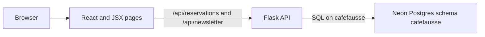
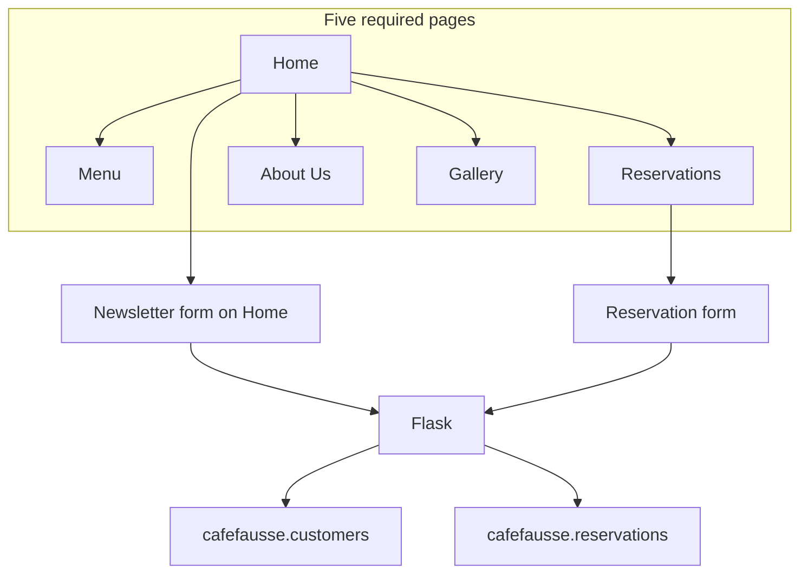
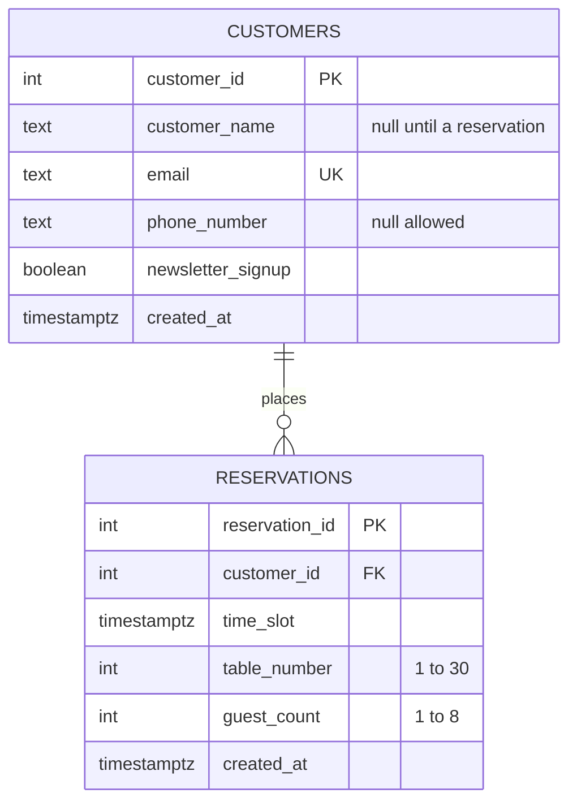
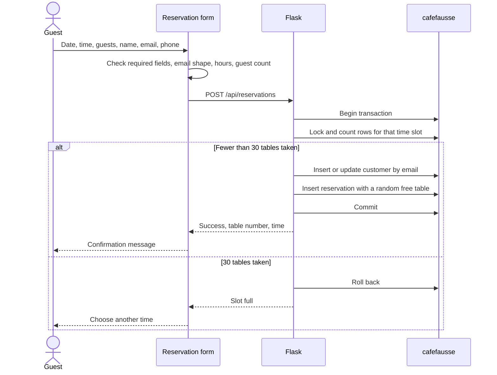
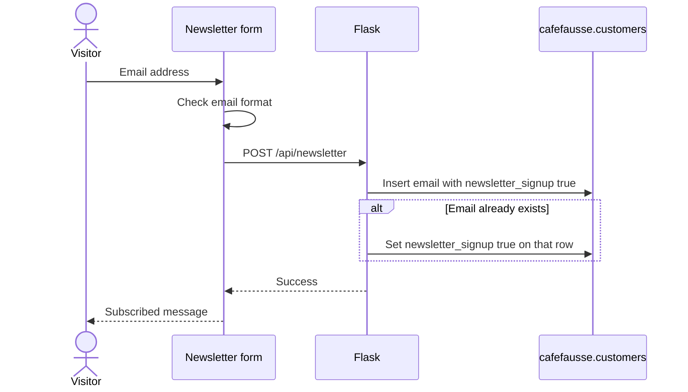
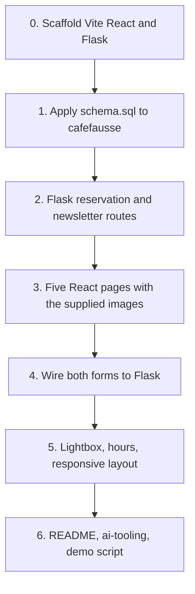

# Café Fausse development plan

Working plan for the Quantic web application. It follows `documentation/Project 2 - Web App & Interface Design Presentation.pdf` and `documentation/Cafe_Fausse_SRS.pdf`, and it uses only the photographs in `documentation/Cafe_Fausse_Images/`.

The database is the existing Neon Postgres database in `.env.local` (`DATABASE_URL`). All application tables live in the `cafefausse` schema, which already exists and is empty. The connection string stays in `.env.local` and is not copied into this plan or into source control.

## 1. What “done” means

A score of 5 on the presentation rubric requires all of the following:

- Five pages built with React and JSX: Home, Menu, Reservations, About Us, Gallery.
- Every SRS functional requirement implemented, including the exact menu, contact details, awards, and reviews.
- Layout with CSS Flexbox or CSS Grid, consistent across the site, and usable on desktop, tablet, and phone.
- Working forms for reservations and newsletter signup, with input checks.
- A Flask API and PostgreSQL database integrated with that React front end.
- Reservation logic that assigns a random free table out of 30, confirms success, and refuses a full time slot.
- A recorded demo that shows each page, both forms, and the resulting rows in the database itself (Neon SQL editor or `psql`, not an admin page on the site).
- `README.md` (how to run it) and `ai-tooling.md` (how AI tools were used).

Next.js is out of scope. The graded stack is React with JSX, Flask, and PostgreSQL.

## 2. Stack

| Layer | Choice | Why |
| --- | --- | --- |
| Front end | Vite, React, JavaScript, JSX | Matches the React and JSX requirement without using Next.js. |
| Styling | One global CSS file. CSS Grid for page structure. Flexbox for navigation, cards, and forms. | The rubric accepts either Flexbox or Grid. Using both, each for a clear job, is easy to point at in the demo. |
| API | Flask, Flask-CORS | Required back end. |
| Database driver | `psycopg` (v3) with a small connection pool | Talks to Neon Postgres. The URL in `.env.local` is already the pooled host, which is the right connection for request handling. |
| Schema | `cafefausse` on the existing Neon database | Already created. Tables are always schema-qualified so they do not collide with the other schemas in that database. |
| Config | `python-dotenv` reading `../.env.local` from the Flask app | Keeps `DATABASE_URL` out of the repo. `.gitignore` ignores `.env` and `.env.*`. |

Flask listens on `http://127.0.0.1:5000`. Vite listens on `http://127.0.0.1:5173` and proxies `/api` to Flask during development. The site is demonstrated on localhost. A public staging server is optional.

## Assumptions

The SRS and the presentation leave two reservation rules unspecified. This plan adopts both of the following. Later sections implement them as written here.

### Time slots are every 30 minutes during published hours

The documents give opening hours and a “time slot,” and they do not say how long a slot is. Bookable start times are every 30 minutes, only inside the published hours:

- Monday–Saturday: 5:00 PM, 5:30 PM, 6:00 PM, …, 10:30 PM.
- Sunday: 5:00 PM, 5:30 PM, 6:00 PM, …, 8:30 PM.

Closing time is not a bookable start. The last slot runs until close: 11:00 PM Monday–Saturday and 9:00 PM Sunday. A time outside this list, or not on a 30-minute boundary, is rejected. Stored values are `timestamptz` in `America/New_York`, because the restaurant is in Washington, DC.

### Guest count is stored, from 1 to 8, and does not change table assignment

The reservation form must collect the number of guests. The minimum reservations table in the SRS has no column for that number. This plan stores it as `guest_count` on `cafefausse.reservations`.

Allowed values are the integers 1 through 8. The SRS does not set a maximum; 8 is the cap used here so one party maps to one table. Every accepted reservation still occupies exactly one of the 30 tables. A larger or smaller party does not take extra tables and does not skip the count of 30.

Apply `schema.sql` with the pooled `DATABASE_URL`. These statements are plain `CREATE TABLE` / `CREATE INDEX` and do not need session state. If the pooler rejects a statement, run that file once against the direct host (same URL with `-pooler` removed from the hostname) and keep the pooled URL for the running app.

## 3. System shape





## 4. Data model

The SRS minimum columns are kept. Two extras are added because the reservation form collects data the minimum table cannot store: `guest_count`, and a unique email so a newsletter signup and a later reservation share one customer row.

`customer_name` is nullable. The newsletter form is email-only (FR-15). A reservation always supplies a name and fills it in.



Rules enforced in the database:

- `UNIQUE (email)` on `customers`.
- `CHECK (table_number BETWEEN 1 AND 30)`.
- `CHECK (guest_count BETWEEN 1 AND 8)`.
- `UNIQUE (time_slot, table_number)` so two bookings cannot take the same table at the same instant.
- `UNIQUE (customer_id, time_slot)` so one email cannot reserve more than one table for the same slot. This is a design choice. The SRS does not require it, and it supports the “no double booking” reliability requirement.
- `time_slot` is `timestamptz` in `America/New_York`, as stated in the assumptions.
- `guest_count` is required and limited to 1–8, as stated in the assumptions. It is stored even though the SRS minimum column list omits it.

Intended DDL lives in `cafefausse-backend/schema.sql` and is applied to `cafefausse` only.

## 5. Reservation behavior

Bookable times are the 30-minute slots in the assumptions: Monday–Saturday 5:00 PM through 10:30 PM, and Sunday 5:00 PM through 8:30 PM. Guest count must be an integer from 1 to 8 and is saved on the reservation row. A slot is full when 30 reservations already exist for that `time_slot`. Party size does not change how many tables are taken.



Concurrency: the unique constraint on `(time_slot, table_number)` is the real guard. If two requests pick the same free table, the loser gets a unique-violation, picks another free table, and retries. If the count is already 30, the API returns the “choose another time” error and writes nothing.

Customer matching is by email:

- New email: insert a customer, then the reservation.
- Known email: update name and phone, then insert the reservation. `newsletter_signup` is left as it was unless this request also opts in. The reservation form does not include a newsletter checkbox. Newsletter signup is the separate form.

Success response includes the assigned table number so the confirmation message is specific. Error response for a full slot does not include a table number.

## 6. Newsletter behavior



A repeat signup is success, not an error. The row is updated in place. Name and phone already stored for that email are not cleared.

## 7. HTTP API

| Method and path | Body | Result |
| --- | --- | --- |
| `GET /api/health` | none | `{ "ok": true }` |
| `GET /api/availability?time_slot=` | none | `{ "booked": n, "remaining": 30 - n }` for the form, so a full slot can be warned before submit |
| `POST /api/reservations` | `time_slot`, `guest_count`, `customer_name`, `email`, `phone_number` optional | `201` with `reservation_id`, `table_number`, `time_slot`, or `409` when the slot is full, or `400` when the input is invalid |
| `POST /api/newsletter` | `email` | `200` with the customer id and `newsletter_signup: true` |

JSON only. Flask-CORS allows the Vite origin in development.

Validation runs in the browser and again in Flask. The database constraints are the last line. The UI messages:

- Missing or badly shaped email.
- Guest count outside 1–8.
- Time outside the hours above, or not on a 30-minute boundary.
- Slot full: ask the guest to pick another time.
- Saved: name, time in Eastern Time, and table number.
- Newsletter saved: the address is on the list.

## 8. Pages and photographs

Copy the four WebP files into `cafefausse-frontend/public/images/` at build time (or reference them from that folder). Leave the originals in `documentation/Cafe_Fausse_Images/`. No other photographs are required. Additional royalty-free or generated images are optional and not part of this plan.

Shared chrome on every page: a header with the name Café Fausse and links to Home, Menu, Reservations, About Us, and Gallery, plus a footer with the address, phone, and hours. Header uses Flexbox. The page column uses Grid.

### Home

- Hero image: `home-cafe-fausse.webp` (ornate dining room, blue curtains, central aisle). Full-bleed, with the restaurant name over it.
- Contact block, exact SRS text:
  - 1234 Culinary Ave, Suite 100, Washington, DC 20002
  - (202) 555-4567
  - Monday–Saturday 5:00 PM – 11:00 PM; Sunday 5:00 PM – 9:00 PM
- Short intro drawn from the About text (founded 2010, Chef Antonio Rossi and Maria Lopez).
- Three award names, linking to the Gallery section that holds the full list.
- Newsletter form.
- A reservation link.

### Menu

Categories, items, descriptions, and prices are copied from the SRS and not rewritten.

| Category | Item | Price |
| --- | --- | --- |
| Starters | Bruschetta — Fresh tomatoes, basil, olive oil, and toasted baguette slices | $8.50 |
| Starters | Caesar Salad — Crisp romaine with homemade Caesar dressing | $9.00 |
| Main Courses | Grilled Salmon — Served with lemon butter sauce and seasonal vegetables | $22.00 |
| Main Courses | Ribeye Steak — 12 oz prime cut with garlic mashed potatoes | $28.00 |
| Main Courses | Vegetable Risotto — Creamy Arborio rice with wild mushrooms | $18.00 |
| Desserts | Tiramisu — Classic Italian dessert with mascarpone | $7.50 |
| Desserts | Cheesecake — Creamy cheesecake with berry compote | $7.00 |
| Beverages | Red Wine (Glass) — A selection of Italian reds | $10.00 |
| Beverages | White Wine (Glass) — Crisp and refreshing | $9.00 |
| Beverages | Craft Beer — Local artisan brews | $6.00 |
| Beverages | Espresso — Strong and aromatic | $3.00 |

Place `gallery-ribeye-steak.webp` next to the Ribeye Steak item only. The other dishes stay text. The SRS does not supply photographs for them.

### Reservations

Form fields, in order: time slot (date plus a select of the legal 30-minute times), number of guests, customer name, email, phone (optional). Submit calls `POST /api/reservations`. Show the success or “pick another time” message in the page, not only in the console.

### About Us

Use the SRS history verbatim in substance:

> Founded in 2010 by Chef Antonio Rossi and restaurateur Maria Lopez, Café Fausse blends traditional Italian flavors with modern culinary innovation. Our mission is to provide an unforgettable dining experience that reflects both quality and creativity.

FR-11 also asks for founder biographies and a note on locally sourced ingredients. The SRS does not provide biographical detail beyond those roles. Write two short paragraphs that restate only those facts (chef and founder; restaurateur and founder; Italian tradition with modern technique; locally sourced ingredients). Do not invent dates of birth, restaurants they worked in, or awards that are not in the SRS.

Use `gallery-cafe-interior.webp` as the about-page photograph (dining room, chandelier, set tables).

### Gallery

Lightbox on every image (click opens a large view, click or Escape closes it). Keyboard focus stays inside the dialog while it is open.

| File | Caption |
| --- | --- |
| `gallery-cafe-interior.webp` | Interior of the dining room |
| `home-cafe-fausse.webp` | The main dining room |
| `gallery-ribeye-steak.webp` | Ribeye steak |
| `gallery-special-event.webp` | A special event in the dining room |

Awards, exact wording:

- Culinary Excellence Award – 2022
- Restaurant of the Year – 2023
- Best Fine Dining Experience – Foodie Magazine, 2023

Reviews, exact wording:

- “Exceptional ambiance and unforgettable flavors.” – Gourmet Review
- “A must-visit restaurant for food enthusiasts.” – The Daily Bite

## 9. Visual system

Fine-dining, dark and warm, taken from the photographs: near-black brown, antique gold, cream linen, candlelight. Cream page background, dark header, gold links and buttons. Body text stays dark on cream so it remains readable. One typeface for headings and one for body, both from a system stack or a single royalty-free web font. No second theme.

Responsive behavior:

- Desktop: header in one row, menu categories in a two-column grid, gallery in a three- or four-column grid.
- Tablet and phone: header links wrap or collapse into a single control, menu and gallery become one column, forms stack label over field. Flexbox and Grid do this with `auto-fit` / `minmax` rather than a separate mobile stylesheet where possible.

Targets from the SRS: first load under 3 seconds on a normal connection, form round-trip under 2 seconds, works in Chrome, Firefox, Safari, and Edge.

## 10. Repository layout

```text
cafe-fausse/
  .gitignore
  README.md
  ai-tooling.md
  cafefausse-backend/
    .env.local               # DATABASE_URL, not committed
    app.py
    schema.sql
    requirements.txt
    start.sh
  cafefausse-frontend/
    index.html
    package.json
    vite.config.js
    public/images/           # copies of the four WebP files
    src/
      main.jsx
      App.jsx
      api.js
      styles.css
      pages/
        Home.jsx
        Menu.jsx
        Reservations.jsx
        About.jsx
        Gallery.jsx
      components/
        Layout.jsx
        NewsletterForm.jsx
        Lightbox.jsx
  documentation/             # unchanged source material plus this plan
```

Routing is client-side (`react-router-dom`) with paths `/`, `/menu`, `/reservations`, `/about`, `/gallery`.

## 11. Build order



1. **Scaffold.** Vite React app in `cafefausse-frontend/`, Flask app in `cafefausse-backend/` that loads `.env.local` and connects with `search_path` unused — every statement names `cafefausse`. Confirm `GET /api/health` from the browser.
2. **Schema.** Run `schema.sql` against `cafefausse`. Confirm both tables with `\dt cafefausse.*` or the Neon SQL editor. Do not create tables in `public`.
3. **API.** Implement the four routes and the transaction described above. Exercise them with `curl` before any form exists: one successful booking, a 31st booking on that same slot, a bad email, and a newsletter insert plus a repeat.
4. **Pages.** Static React pages with the SRS copy and the four images. Navigation between all five routes.
5. **Forms.** Newsletter on Home and the reservation form post to Flask and render the API message.
6. **Finish.** Lightbox, hour-aware time select, responsive Grid and Flexbox, focus states, and empty/error text.
7. **Submission files.** `README.md` with environment setup, `pip install`, `npm install`, how to apply `schema.sql`, and how to start Flask and Vite. `ai-tooling.md` with a short account of which AI tools were used and what helped or failed. Add `quantic-grader` as a collaborator on the private GitHub repo before submission. `staging.md` is optional; if the app stays on localhost, say so.

## 12. Demo script

Record 5–10 minutes, camera on, government ID shown, name stated. On screen, in this order:

1. Walk Home, Menu, Reservations, About Us, and Gallery, including the lightbox.
2. Submit the newsletter form with a valid email, then show the new or updated row in `cafefausse.customers`.
3. Submit a reservation inside opening hours. Show the confirmation, then the new row in `cafefausse.reservations` joined to that customer, including the assigned table.
4. Fill the same time slot to 30 tables, or temporarily lower the cap in a way you explain, and show the “pick another time” message with no extra row written. For the recording, a SQL count of existing rows plus one more booking is enough if 30 real inserts would waste the demo. Prefer inserting until full if time allows, using a small script you also show.
5. Say which choices were made: Vite rather than Next.js, Neon schema `cafefausse`, 30-minute slots, guest count stored even though it was not in the minimum column list.

## 13. Checks before calling it finished

- All five routes render and the header links work.
- Menu text and prices match the SRS table in this plan.
- Address, phone, and hours match the SRS on Home and in the footer.
- Awards and both reviews match the SRS on Gallery.
- Newsletter rejects `not-an-email` and stores a valid address with `newsletter_signup = true`.
- Reservation rejects a closed time, a guest count of 0 and of 9, and a missing name.
- A free slot returns one table from 1–30 that is not already used at that time.
- The 31st reservation for a slot returns the full-slot message and does not insert a row.
- Two rapid bookings do not receive the same table number.
- Layout is readable at a phone width and a desktop width in Chrome.
- `.env.local` is not in the git status list.
